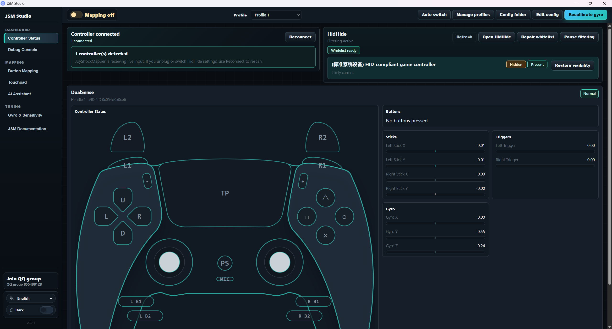

# JSM Studio

[`Chinese Documentation`](./README_zh.md)

JSM Studio is a graphical tool for JoyShockMapper on Windows. It integrates JoyShockMapper’s gyro aiming, key mapping, config management into a single desktop application, with a link to the official HidHide download, aiming to enable users to complete common configuration tasks without using the command line.



This repository is a fork of [`evan1mclean/JSM_custom_curve`](https://github.com/evan1mclean/JSM_custom_curve), with JoyShockMapper maintained separately in [`hotuns/JoyShockMapper`](https://github.com/hotuns/JoyShockMapper). The JSM Studio repository pins that fork as the `JoyShockMapper` submodule on its `jsm-studio` branch. The fork's `main` branch tracks [`Electronicks/JoyShockMapper`](https://github.com/Electronicks/JoyShockMapper), while the integration branch preserves custom curves and the telemetry/controller interfaces required by this desktop application.

Future maintenance follows `Electronicks/JoyShockMapper` as the sole engine
upstream; this project no longer tracks updates from
`evan1mclean/JSM_custom_curve`. Existing custom curves are retained, the GUI is
developed independently, and SDL is upgraded independently when needed. Engine
updates are integrated from source, tested, and rebuilt to preserve Studio's
required interfaces. See the [upstream workflow](docs/joyshockmapper-upstream.md).

## Download

Download the latest installer from GitHub Releases:

[Download Latest JSM Studio](https://github.com/hotuns/JSM_Studio/releases/latest)

You can also browse the Releases list for specific versions:

[All Releases](https://github.com/hotuns/JSM_Studio/releases)

Windows users usually just need the `.exe` installer from the Release assets; if you need MSI, you can download the `.msi` file as well.

## Differences from the Forked Upstream

Compared to [`evan1mclean/JSM_custom_curve`](https://github.com/evan1mclean/JSM_custom_curve), major improvements in this repository include:

- **Tauri Desktop App**: GUI has moved to Tauri; backend directly manages JoyShockMapper processes, config files, runtime directories, and system-level operations.
- **Bundled JoyShockMapper Runtime**: The application includes both SDL / legacy backends, switchable via the interface. Users do not need to locate or launch `JoyShockMapper.exe` manually.
- **Reworked Controller Connection Flow**: On launch, JSM Studio no longer connects to all controllers automatically. Instead, it shows available SDL controllers for the user to select and connect.
- **HidHide Download**: Links to the official download page for optional, separately installed controller hiding.
- **Standard Permissions by Default**: The app no longer requires elevation. Run as administrator only when needed, such as sending keyboard/mouse input to an elevated game.
- **Enhanced Config Management**: Provides config directories, text editing, management, fast switching, and automatic per-game switching panels.
- **Redesigned Auto-Switch Panel**: Supports loading configs based on game process rules; rules and their enabled status are managed in the GUI.
- **Redesigned Controller Status Page**: Prompts for controller selection when not connected; after connecting, shows real-time input status and a HidHide download link.
- **Reworked Touchpad Interaction**: Select touchpad mode/dividing method first, then assign mappings to different touch areas.
- **Overall UI Refactor**: Redundant top bar removed, clearer tooltips, unified left navigation bar, language/appearance switch, and global controls’ styling.
- **Automated Release Build**: GitHub Actions workflows build and upload Windows installers to Releases automatically when pushing a `v*` tag.

## Main Features

- Controller detection, selection, and real-time input view
- Enable/disable mapping output
- Button mapping, touchpad mapping, gyro & sensitivity configuration
- Config file management, editing, and quick switching
- Auto-switch profiles by game process
- Official HidHide download link
- Embedded JSM documentation links
- Simplified Chinese / English interface
- Dark theme


## Basic Usage Steps

1. Install and run JSM Studio as administrator.
2. On the "Controller Status" page, refresh device list and connect your preferred controller.
3. In the "Button Mapping", "Touchpad", or "Motion Control" pages, configure your mappings.
4. Toggle "Enable Mapping" to let JoyShockMapper output your configuration.
5. If your game sees both the physical controller and causes double input, use the HidHide download link, install it separately, and configure its application allowlist and device hiding.
6. Test in game. For automatic profile switching, add the relevant rule in the "Auto-Switch" panel.

## Data Flow

JSM Studio has two related but separate controller data paths: controller discovery/connection and real-time input telemetry.

### Controller Discovery and Connection

This path is used when the "Controller Status" page refreshes the list of available controllers.

```text
[Physical controller raw input]
   |
   v
[Windows HID device stack]
   |
   v
[HidHide filter layer, if enabled]
   |
   v
[JoyShockMapper.exe, whitelisted when HidHide is active]
   |
   v
[SDL / JSL wrapper]
   |
   v
[LIST_CONTROLLERS command]
   |
   v
[JSM console output: JSM_CONTROLLER rows]
   |
   v
[jsm-console-injector --capture]
   |
   v
[Tauri backend parses ControllerCandidate[]]
   |
   v
[React ControllerStatusPage shows clickable controller cards]
   |
   v
[User clicks one controller]
   |
   v
[Tauri sends RECONNECT_CONTROLLERS SELECT <deviceId>]
   |
   v
[JoyShockMapper connects only the selected SDL device]
```

The device list shown in the UI comes from JoyShockMapper's SDL enumeration, not directly from the browser or from HidHide. HidHide can still show a device even when JSM cannot see it, so the important condition is that the currently running `JoyShockMapper.exe` is present in the HidHide whitelist.

### Real-Time Input and Mapping

After a controller is connected, live input no longer comes from `LIST_CONTROLLERS`. JoyShockMapper polls the selected SDL device and sends telemetry to the Tauri backend.

```text
[Physical controller raw input]
   |
   v
[Windows HID device stack]
   |
   v
[HidHide filter layer]
   |
   v
[JoyShockMapper.exe]
   |
   v
[SDL / JSL polling]
   |
   v
[joyShockPollCallback]
   |
   +--> [JSM mapping logic]
   |        |
   |        v
   |    [Keyboard / mouse / virtual controller output]
   |
   +--> [JSM telemetry JSON over UDP 127.0.0.1:8974]
            |
            v
      [Tauri telemetry service]
            |
            v
      [telemetry-sample event]
            |
            v
      [React useTelemetry hook]
            |
            v
      [Controller Status live buttons, sticks, triggers, gyro]
```

JSM Studio writes these fixed telemetry settings into the runtime config so the GUI can receive live status:

```text
TELEMETRY_ENABLED = ON
TELEMETRY_PORT = 8974
```

### HidHide Position in the Flow

HidHide is a visibility filter, not the mapper itself. Its job is to hide the physical controller from games while allowing JoyShockMapper to keep reading it.

```text
[Physical controller]
   |
   v
[HidHide]
   |
   +--> [Whitelisted JoyShockMapper.exe] can still see the controller
   |
   +--> [Game process] cannot see the hidden physical controller
```

This prevents double input: the game receives JSM's mapped keyboard/mouse or virtual-controller output, but not the original physical controller input.

## About HidHide

JSM Studio continues to use the Tauri desktop architecture. HidHide is an optional external tool. The app only links to the [official download page](https://github.com/nefarius/HidHide/releases/latest); it does not bundle an installer or manage device hiding, filtering, or the application allowlist.

Install and configure HidHide separately when needed to prevent double input. Allow the current JoyShockMapper.exe to read devices before hiding the physical controller from games. Check the allowlist path after reinstalling, switching backends, or moving the application.

## Auto-Switch Configuration

Auto-switching works by matching running game process names. Each rule maps a game `.exe` to a JSM config file. When the foreground window switches to that game, JSM Studio will auto-load the matching config.

How to use:

1. Prepare a config file in the Config Manager.
2. In the Auto-Switch panel, enable "Auto-Switch by Game".
3. Add a rule by selecting the game process name and profile file.
4. Launch the game and switch to its window. JSM Studio will switch configs per your rule.

Note: The rule name should match the actual game process, e.g. `game.exe`. If you’re unsure, check the process name in Task Manager when the game is running.

## Development

### Environment

- Windows
- Node.js
- Rust
- Visual Studio Build Tools / MSVC
- CMake

### Run Tauri Dev Version

```powershell
cd JSM_GUI/jsm_gui_tauri
git -C ..\.. submodule update --init --recursive
npm install
npm run tauri:dev
```

When the JoyShockMapper submodule changes, rebuild the bundled SDL runtime
before packaging:

```powershell
npm run build:joyshockmapper
```

See [the JoyShockMapper upstream workflow](docs/joyshockmapper-upstream.md)
for the fork synchronization procedure.

For daily development, run `npm run tauri:dev` (or `npm run dev`) from a standard terminal. The Windows manifest uses `asInvoker`: it does not request elevation, but inherits the launcher's permissions. Close an elevated terminal and open a standard one to run without elevation.

Use `npm run tauri:dev:admin` only when testing scenarios such as keyboard/mouse injection into an elevated game. This explicit command still requests administrator access. Driver installation and updates to an application installed in a protected directory may separately require installer elevation.

Profile management, controller reading, gyro calibration, and telemetry do not require default elevation. Automatic profile switching queries the foreground process; the current engine may be unable to query elevated or protected processes. Virtual controller use requires an installed, accessible driver; installing that driver is a separate permission requirement.

### Build Installer

```powershell
cd JSM_GUI/jsm_gui_tauri
npm run tauri:build
```

After building, installers are usually found at:

```text
JSM_GUI/jsm_gui_tauri/src-tauri/target/release/bundle/nsis/
JSM_GUI/jsm_gui_tauri/src-tauri/target/release/bundle/msi/
```

## Release

This repository uses GitHub Actions to automatically publish Windows installers.

Push a version tag:

```powershell
git tag -a v0.2.1 -m "JSM Studio v0.2.1"
git push origin v0.2.1
```

GitHub Actions will build and upload `.exe` / `.msi` files to the corresponding GitHub Release.

## Upstream & Related Projects

- This repo: [`hotuns/JSM_Studio`](https://github.com/hotuns/JSM_Studio)
- Forked upstream: [`evan1mclean/JSM_custom_curve`](https://github.com/evan1mclean/JSM_custom_curve)
- JoyShockMapper: [`JibbSmart/JoyShockMapper`](https://github.com/JibbSmart/JoyShockMapper)
- HidHide: [`nefarius/HidHide`](https://github.com/nefarius/HidHide)
- GyroWiki: [`gyrowiki.jibbsmart.com`](http://gyrowiki.jibbsmart.com)

## License

JoyShockMapper uses the MIT License. See [LICENSE.md](LICENSE.md) for details.
