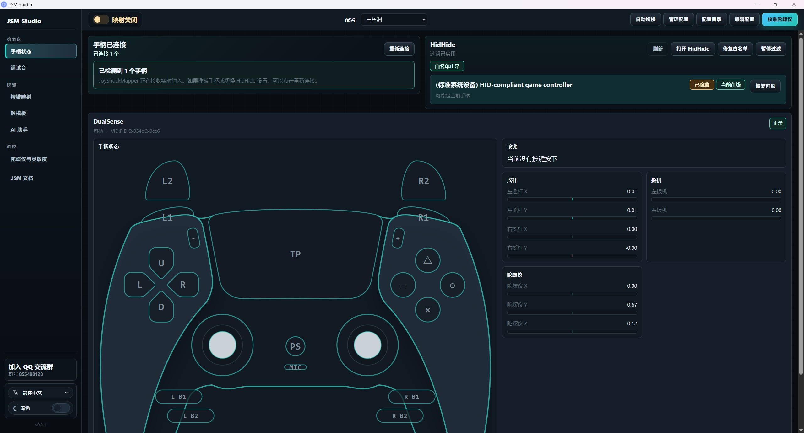
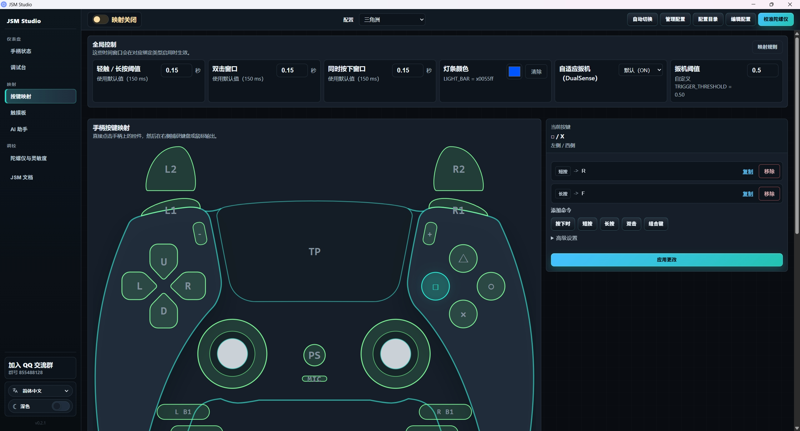
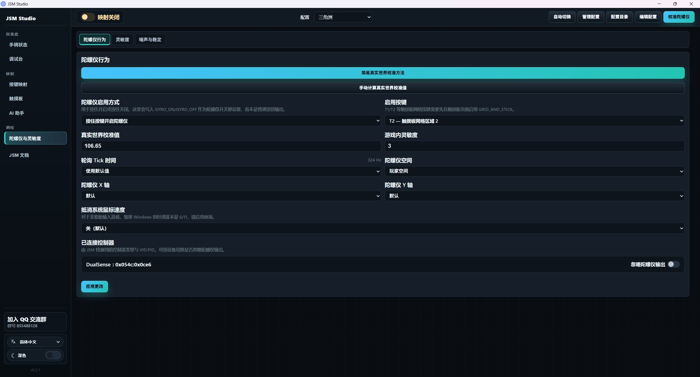

# JSM Studio

[`英文文档`](./README.md)

JSM Studio 是一个面向 Windows 的 JoyShockMapper 图形化工具。它将 JoyShockMapper 的体感瞄准、按键映射和配置管理整合到一个桌面应用中，并提供 HidHide 官方下载入口，让用户通过界面完成常见配置。




本仓库是 [`evan1mclean/JSM_custom_curve`](https://github.com/evan1mclean/JSM_custom_curve) 的 fork，JoyShockMapper 现独立维护在 [`hotuns/JoyShockMapper`](https://github.com/hotuns/JoyShockMapper)。本仓库通过 `jsm-studio` 分支 submodule 使用该 fork；该 fork 的 `main` 分支跟随 [`Electronicks/JoyShockMapper`](https://github.com/Electronicks/JoyShockMapper)，`jsm-studio` 分支保留自定义曲线以及 Tauri 所需的控制器和 telemetry 接口。

后续维护以 `Electronicks/JoyShockMapper` 为唯一引擎上游，不再跟随 `evan1mclean/JSM_custom_curve` 的更新。已集成的自定义曲线继续保留，GUI 独立开发，SDL 按需独立升级。引擎更新通过源码集成、验证和重新构建内置运行时完成，以保留 Studio 所需接口；详见[上游维护流程](docs/joyshockmapper-upstream.md)。

## 下载

从 GitHub Release 下载最新版安装包：

[下载最新版 JSM Studio](https://github.com/hotuns/JSM_Studio/releases/latest)

也可以进入 Release 列表选择具体版本：

[全部 Release](https://github.com/hotuns/JSM_Studio/releases)

Windows 用户通常下载 Release 附件里的 `.exe` 安装包即可；如果需要 MSI，也可以下载 `.msi` 文件。

## 与 fork 源仓库的区别

相对 [`evan1mclean/JSM_custom_curve`](https://github.com/evan1mclean/JSM_custom_curve)，本仓库重点变化如下：

- **Tauri 桌面应用**：GUI 已迁移到 Tauri，后端直接管理 JoyShockMapper 进程、配置文件、运行时目录和系统级操作。
- **内置 JoyShockMapper 运行时**：应用内置 SDL / legacy 后端，并通过界面切换，不要求用户手动寻找或启动 `JoyShockMapper.exe`。
- **手柄连接流程重做**：启动后不会自动连接所有手柄，而是先显示可用 SDL 手柄，由用户点击选择要连接的设备。
- **HidHide 下载入口**：需要避免双重输入时，可跳转官方下载页面，自行安装和配置。
- **默认普通权限运行**：应用不再强制请求管理员权限；仅在需要向提权游戏发送键鼠输入等场景下按需以管理员身份启动。
- **配置管理增强**：提供配置目录、配置文本编辑、配置管理、快速切换和按游戏自动切换面板。
- **自动切换面板重做**：支持按游戏进程规则加载配置，规则文件与开关状态在 GUI 中管理。
- **手柄状态页重做**：未连接手柄时优先引导用户选择手柄，连接后再显示实时输入状态和 HidHide 下载入口。
- **触摸板交互重做**：先选择触摸板模式/分割方式，再为不同触摸区域分配映射。
- **整体 UI 重构**：移除冗余顶部栏，简化工具文案，统一左侧导航、语言切换、主题切换和全局控制区样式。
- **Release 自动构建**：仓库包含 GitHub Actions 发布流程，推送 `v*` tag 后自动构建 Windows 安装包并上传到 GitHub Release。

## 主要功能

- 手柄检测、选择连接和实时输入查看
- 映射开启 / 关闭
- 体感控制（陀螺仪、灵敏度、噪声与稳定）、按键映射和触摸板映射
- 配置文件管理、编辑和快速切换
- 按游戏进程自动切换配置
- HidHide 官方下载跳转
- 内置 JSM 文档入口
- 简体中文 / English 界面
- 深色主题






## 基础使用流程

1. 安装并启动 JSM Studio，默认无需管理员权限。
2. 在「手柄状态」页面刷新设备列表，点击要使用的手柄进行连接。
3. 在「按键映射」「触摸板」「体感控制」页面配置映射。
4. 打开「映射开启」开关，让 JoyShockMapper 输出当前配置。
5. 如果游戏会同时识别实体手柄并造成双输入，通过「HidHide」下载入口自行安装，并在 HidHide 配置工具中设置白名单和隐藏实体手柄。
6. 进入游戏测试。如果需要按游戏自动切换配置，在「自动切换」面板添加对应游戏进程规则。

## HidHide 说明

JSM Studio 继续使用 Tauri 桌面架构。HidHide 是可选的独立工具，应用仅提供[官方下载入口](https://github.com/nefarius/HidHide/releases/latest)，不再内置安装器或提供设备隐藏、过滤开关、白名单修复等管理功能。

如需避免双重输入，请自行安装 HidHide，在其配置工具中允许当前使用的 JoyShockMapper.exe 读取设备，再选择需要对游戏隐藏的实体手柄。重新安装、切换后端或移动程序后，请确认白名单中的路径仍正确。

## 自动切换配置

自动切换基于游戏进程名工作。每条规则对应一个游戏 `.exe` 和一个 JSM 配置文件。当前台窗口切换到该游戏时，JSM 会自动加载对应配置。

使用方式：

1. 打开配置管理，准备一个要用于游戏的配置。
2. 进入自动切换面板，开启「按游戏自动切换」。
3. 添加规则，选择游戏进程名和配置文件。
4. 启动游戏并切到游戏窗口，JSM Studio 会按规则加载配置。

注意：规则名应对应实际游戏进程，例如 `game.exe`。如果不确定进程名，可以先运行游戏，再从任务管理器查看。

## 开发

### 环境

- Windows
- Node.js
- Rust
- Visual Studio Build Tools / MSVC
- CMake

### 运行 Tauri 开发版

  ```powershell
cd JSM_GUI/jsm_gui_tauri
git -C ..\.. submodule update --init --recursive
npm install
npm run tauri:dev
  ```

如果 JoyShockMapper submodule 有更新，打包前先重新构建内置 SDL 运行时：

```powershell
npm run build:joyshockmapper
```

同步流程详见 [`docs/joyshockmapper-upstream.md`](docs/joyshockmapper-upstream.md)。

日常开发在普通权限终端中运行 `npm run tauri:dev`（或 `npm run dev`）。Windows manifest 使用 `asInvoker`，不再强制提权，但会继承启动终端的权限；已经提权的终端需要关闭后重新打开普通终端。

仅在目标游戏以管理员权限运行、需要测试向其发送键鼠输入时，使用 `npm run tauri:dev:admin`。此命令仍会主动请求管理员权限。安装驱动或更新安装在受保护目录中的应用，也可能由对应安装器单独请求提权。

配置管理、手柄读取、陀螺仪校准、遥测不要求默认提权。按游戏自动切换使用前台进程信息；当前引擎对提权或受保护进程的查询可能受限。虚拟手柄运行需要已安装且可访问的驱动，驱动安装与应用日常运行是不同的权限场景。

### 构建安装包

```powershell
cd JSM_GUI/jsm_gui_tauri
npm run tauri:build
```

构建完成后，安装包通常位于：

```text
JSM_GUI/jsm_gui_tauri/src-tauri/target/release/bundle/nsis/
JSM_GUI/jsm_gui_tauri/src-tauri/target/release/bundle/msi/
```

## 发布

本仓库使用 GitHub Actions 自动发布 Windows 安装包。

推送版本 tag：

```powershell
git tag -a v0.2.1 -m "JSM Studio v0.2.1"
git push origin v0.2.1
```

GitHub Actions 会自动构建并把 `.exe` / `.msi` 上传到对应 GitHub Release。

## 上游与相关项目

- 本仓库：[`hotuns/JSM_Studio`](https://github.com/hotuns/JSM_Studio)
- Fork 源仓库：[`evan1mclean/JSM_custom_curve`](https://github.com/evan1mclean/JSM_custom_curve)
- JoyShockMapper 上游：[`Electronicks/JoyShockMapper`](https://github.com/Electronicks/JoyShockMapper)
- JoyShockMapper 集成 fork：[`hotuns/JoyShockMapper`](https://github.com/hotuns/JoyShockMapper)
- HidHide：[`nefarius/HidHide`](https://github.com/nefarius/HidHide)
- GyroWiki：[`gyrowiki.jibbsmart.com`](http://gyrowiki.jibbsmart.com)

## License

JoyShockMapper 使用 MIT License，详见 [LICENSE.md](LICENSE.md)。
